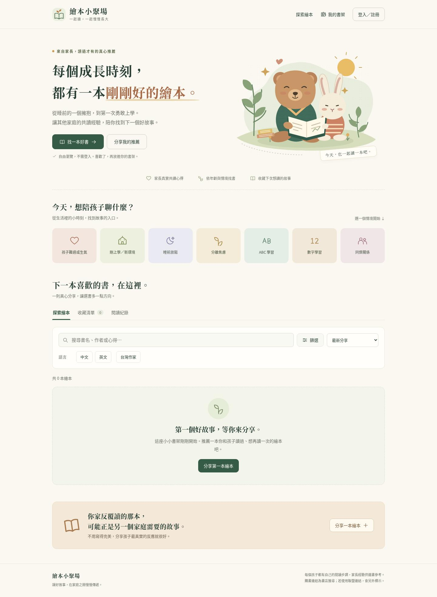
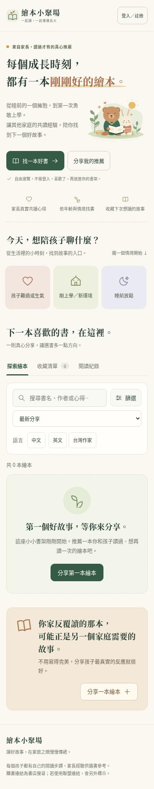

# 繪本小聚場：童趣書店風格改版

以「依情境找書 → 看家長推薦 → 收藏或分享」為主要使用路徑，使用奶油白、森林綠、杏桃色及本地共讀插畫。無須新增套件、編譯或變更資料庫。

## 桌機預覽

## 手機預覽

預覽使用既有公開資料；目前沒有公開書籍，因此呈現邀請第一位家長分享的空書架。測試用書籍與心得沒有加入正式資料庫。

## 介面調整

- 首頁用生活情境引導找書，七個情境可點擊套用，也可再次點擊取消。
- 搜尋可一鍵清除；更多條件可展開，已選條件在收合後仍然可見且能逐一移除。
- 書卡呈現完整比例的書封、家長心得摘要與年齡建議。沒有照片時，明確標示尚無封面；沒有投票時，不顯示推定年齡。
- 收藏與閱讀紀錄有各自的登入及空書架提示，資料載入失敗可重試。
- 投稿先呈現書名與共讀經驗，照片、主題及陪讀建議放在可展開的補充區域，所有原有欄位保留。
- 彈窗限制鍵盤焦點、關閉後還原焦點；照片可使用鍵盤開啟與關閉。手機版維持明確的點擊區域，並尊重減少動態效果的系統設定。
- 沒有團購資料時，首頁不顯示集氣篩選或通知頁籤；原有團購功能仍保留。

## 已完成的驗證

- Chromium：320、390、720、768、1024、1440 像素寬度，沒有整頁橫向溢出。
- 以空資料與六本測試書籍驗證搜尋、語言、台灣作家、情境篩選、逐項移除條件、無結果提示與書籍詳情。
- 驗證收藏登入提示、彈窗鍵盤操作、照片放大及關閉，以及使用攔截請求的投稿、收藏、閱讀紀錄流程；沒有正式寫入。
- 模擬 API 失敗並成功重試，確認可恢復顯示書單。
- axe-core 4.10.3：桌機、手機、展開篩選、書籍詳情及登入視窗，在 WCAG 2 A／AA、2.1 AA 規則檢查中沒有偵測到違規。自動檢查不涵蓋所有無障礙需求。
- 既有 Supabase 的十次公開讀取皆回應 200。雲端瀏覽器的代理憑證限制以保留 TLS 驗證的 GET 轉接處理；沒有關閉憑證驗證。

本次未驗證真實登入信件送達、Email 連結返回網站或使用者／管理者的正式資料庫寫入。需要用真實帳號另外驗證這些既有服務。

## 部署

將本次變更合併到目前 GitHub Pages 使用的 `main` 分支後，由既有 Pages 設定發布。`index.html`、`styles.css`、`config.js` 和 `assets/` 必須保留相對位置；不需要重跑 SQL。
