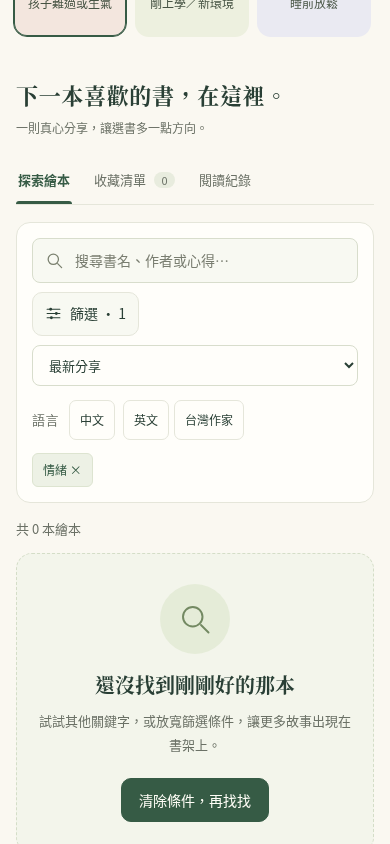
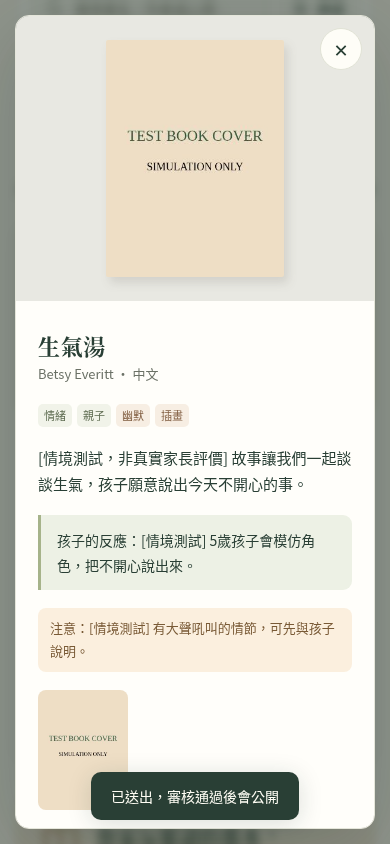
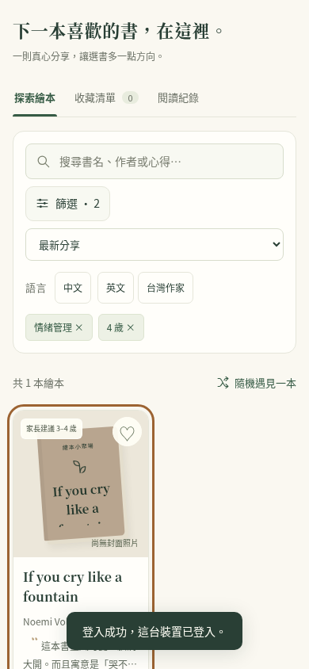
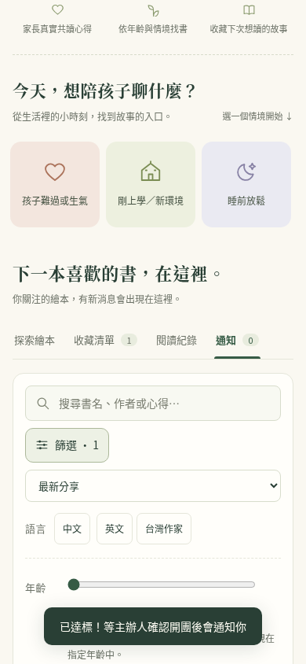
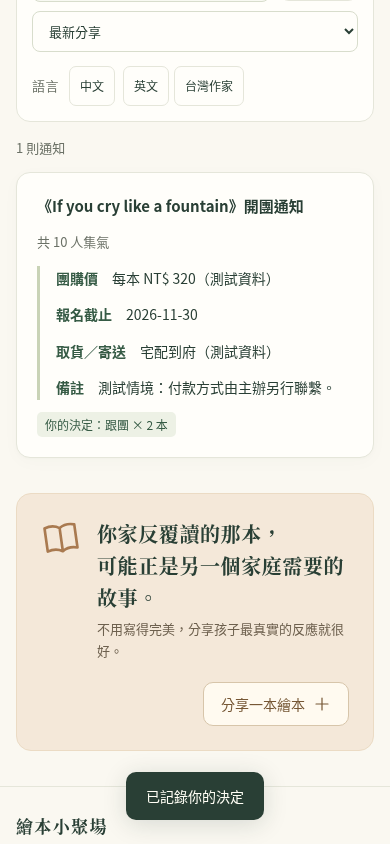

# 繪本小聚場：兩種媽媽角色的完整操作紀錄

紀錄日期：2026-11-11（UTC+8）。檢查版本：[`767f085`](https://github.com/MirandaLin0611/bookstore/commit/767f0853c1c899475ce2c17cf1a9a4225031fdc2)。

## 這份紀錄怎麼產生

以 Chromium 手機寬度 390 × 844 逐步操作畫面；管理員補充流程使用桌機寬度 1440。每一筆記錄是一個點擊、欄位輸入、篩選變更、頁面切換、閱讀或狀態檢查；填寫欄位時必要的畫面定位包含在該筆操作內。沒有以自動化執行時間推估真人使用時間。

正式站的公開畫面與資料先實際讀取。完整流程使用與正式網站相同的前端程式，登入、上傳、投稿、審核、收藏與跟團則使用隔離的測試後端；測試碼、Email、媽媽暱稱、投稿心得、圖片、團購價及報名均為模擬資料。**本次沒有寄出真實登入信，正式資料庫寫入為 0，也沒有修改網站功能。**

這是 AI 代入使用情境的操作檢查；不能把下列推測的使用者感受當成真實家長訪談結果。資料庫權限、實際寄信送達、正式審核寫入及團購郵件發送不在本次端到端驗證範圍。

共 118 筆記錄：正式公開瀏覽 7 筆；5 歲孩子媽媽 36 筆；指定需求找書與收藏 29 筆；隨意逛書 9 筆；有團購資料的補充情境 17 筆；管理者及訪客補充 20 筆。

[下載或檢視 CSV 逐筆紀錄](user-journeys-2026-11-11.csv)。CSV 與下表均保留全部 118 筆，順序依實際操作發生時間排列；各角色步驟使用固定代號方便對照。

## 角色與目前書架

- **角色 1：有 5 歲孩子、第一次分享繪本的媽媽。** 目標是登入、設定一次暱稱、推薦《生氣湯》、加入測試照片與共讀建議、送出並確認如何發布。以一般使用者身分進行，審核另由管理員角色補測。
- **角色 2：有 4 歲孩子的媽媽。** 指定需求為「找情緒管理的書，原本偏好中文」；另測試家中有 2 歲手足時的選書。之後模擬同一媽媽再次回訪、沒有特定需求地逛書，並尋找收藏與跟團的機會。「隔天回訪」是情境設定，實際用同一瀏覽器重新開站，沒有真的等待一天。
- 檢查當下正式書架只有《If you cry like a fountain》一本英文繪本，主題欄空白、階段為「情緒管理」、3 歲及 4 歲各一票，共一位家長投票，沒有照片，也沒有開放集氣的書。
- 因目前沒有團購，跟團補充情境額外設定「這本書已有 9 人集氣、目標 10 人」。這是測試前提，不代表正式網站已有團購。

## 結果先看

| 路徑 | 實際走到哪裡 | 主要阻礙 |
|---|---|---|
| 5 歲媽媽投稿 | 可填寫並送出為待審核；模擬管理者核准後，訪客看得到 | 登入後沒有接續投稿；完整表單較長；提交後需自己回來找狀態 |
| 4 歲媽媽指定需求找書 | 可用年齡及階段找到書，再登入收藏 | 首頁情境入口與篩選結果不一致；中文及 2 歲篩選為空；登入不會自動完成收藏 |
| 沒特定需求逛書 | 可排序、隨機開書、回收藏清單 | 書少使探索路徑很快走完；正式資料沒有跟團入口 |
| 隔離情境的跟團 | 可集氣達標、等主辦開團，再選 2 本確認報名 | 開團後原頁不自動更新；確認後沒有修改／取消／聯絡主辦人入口 |

## 完整逐步紀錄

「正式」只代表正式網站公開讀取；「隔離」代表正式版前端配合測試後端，沒有真實帳號或正式寫入。閱讀與狀態觀察也算一筆，不代表這 118 筆全部都是點擊。

### 正式網站公開瀏覽確認（正式）

| 步驟 | 行為／輸入 | 畫面回應與結果 |
|---|---|---|
| L01 | 開啟正式網站手機版 | 載入目前公開書單 |
| L02 | 點「孩子難過或生氣」 | 套用「情緒」條件，顯示找不到書 |
| L03 | 移除「情緒」條件 | 原本的繪本重新出現 |
| L04 | 展開篩選 | 顯示年齡、階段與風格 |
| L05 | 點階段選項的「更多」 | 展開後才看得到情緒管理與睡前共讀等選項 |
| L06 | 選「階段：情緒管理」 | 同樣是情緒需求，這個條件找得到書 |
| L07 | 查看是否有集氣／跟團入口 | 目前沒有開放集氣的書，相關篩選與通知頁籤隱藏 |

### 角色 1：5 歲媽媽投稿（隔離）

| 步驟 | 行為／輸入 | 畫面回應與結果 |
|---|---|---|
| A01 | 開啟首頁 | 顯示原有公開書單 |
| A02 | 點「分享我的推薦」 | 先要求登入，尚未開啟投稿表單 |
| A03 | 輸入測試 Email：mom5@example.com | 欄位保留輸入內容 |
| A04 | 點「寄送登入信」 | 顯示收件地址、驗證碼欄位與重寄倒數 |
| A05 | 到手機信箱查看驗證碼（模擬） | 由測試後端代替寄信；沒有寄出真實信件 |
| A06 | 輸入測試驗證碼：測試驗證碼（模擬，不是真實登入憑證） | 欄位保留輸入內容 |
| A07 | 點「驗證並登入這台裝置」 | 登入成功，返回書單 |
| A08 | 登入後尋找原本的投稿畫面 | 仍在書單，投稿表單沒有自動接續開啟 |
| A09 | 點已登入的帳號 | 開啟帳號設定，可設定公開暱稱 |
| A10 | 填寫公開暱稱：小禾媽媽（測試） | 欄位保留輸入內容 |
| A11 | 儲存暱稱 | 頂部帳號更新成測試暱稱 |
| A12 | 關閉帳號設定 | 回到書單 |
| A13 | 再次點「分享我的推薦」 | 這次開啟投稿表單 |
| A14 | 填寫書名：生氣湯 | 欄位保留輸入內容 |
| A15 | 填寫作者／繪者：Betsy Everitt | 欄位保留輸入內容 |
| A16 | 選擇中文版本 | 版本為中文 |
| A17 | 填寫推薦原因：[情境測試，非真實家長評價] 故事讓我們一起談談生氣，孩子願意說出今天不開心的事。 | 欄位保留輸入內容 |
| A18 | 填寫孩子的反應與實際年齡：[情境測試] 5歲孩子會模仿角色，把不開心說出來。 | 欄位保留輸入內容 |
| A19 | 選擇建議年齡「5歲」 | 5歲被選取 |
| A20 | 選擇情境「情緒管理」 | 情緒管理被選取 |
| A21 | 選擇情境「睡前共讀」 | 睡前共讀被選取 |
| A22 | 展開補充照片、主題與陪讀建議 | 顯示額外欄位，表單變長 |
| A23 | 填寫主題：情緒、親子 | 欄位保留輸入內容 |
| A24 | 填寫畫風或特色：幽默、插畫 | 欄位保留輸入內容 |
| A25 | 選擇一張測試封面照片 | 出現照片縮圖，可移除 |
| A26 | 填寫讀之前的建議：[情境測試] 看封面，聊聊今天有沒有不開心。 | 欄位保留輸入內容 |
| A27 | 填寫閱讀時的互動：[情境測試] 一起模仿主角的表情，再問他可能在想什麼。 | 欄位保留輸入內容 |
| A28 | 填寫讀完後的延伸活動：[情境測試] 畫一張今天的心情。 | 欄位保留輸入內容 |
| A29 | 填寫注意事項：[情境測試] 有大聲吼叫的情節，可先與孩子說明。 | 欄位保留輸入內容 |
| A30 | 未勾照片確認時，點「送出我的推薦」 | 被擋下，提示先確認照片中沒有孩子 |
| A31 | 往回找到照片聲明，勾選確認 | 確認框已勾選；已填內容保留 |
| A32 | 再次送出推薦 | 顯示已送出並等待審核；自己的書單出現待審核書卡 |
| A33 | 點剛投稿的「生氣湯」 | 看得到投稿內容，但提示通過審核才開放投票留言 |
| A34 | 關閉待審核投稿 | 返回自己的書單 |
| A35 | 重新整理，確認投稿狀態 | 登入與暱稱保留，仍顯示審核中 |

### 補充：未登入訪客確認可見性（隔離／訪客）

| 步驟 | 行為／輸入 | 畫面回應與結果 |
|---|---|---|
| Q01 | 以未登入訪客開啟網站 | 看不到尚未核准的生氣湯 |

### 補充：管理者核准發布（隔離／管理員）

| 步驟 | 行為／輸入 | 畫面回應與結果 |
|---|---|---|
| P01 | 管理員開啟網站 | 先顯示公開書單 |
| P02 | 點「登入／註冊」 | 開啟只需要 Email 的登入視窗 |
| P03 | 輸入測試 Email：admin@example.com | 欄位保留輸入內容 |
| P04 | 點「寄送登入信」 | 顯示收件地址、驗證碼欄位與重寄倒數 |
| P05 | 到手機信箱查看驗證碼（模擬） | 由測試後端代替寄信；沒有寄出真實信件 |
| P06 | 輸入測試驗證碼：測試驗證碼（模擬，不是真實登入憑證） | 欄位保留輸入內容 |
| P07 | 點「驗證並登入這台裝置」 | 登入成功，返回書單 |
| P08 | 管理員點「管理後台」 | 待審核清單出現生氣湯 |
| P09 | 管理員檢視書名、心得與照片 | 後台沒有呈現全部投稿欄位（陪讀指南、建議年齡等） |
| P10 | 管理員點「核准公開」 | 狀態更新為公開，待審核清單移除該筆 |

### 補充：未登入訪客確認可見性（隔離／訪客）

| 步驟 | 行為／輸入 | 畫面回應與結果 |
|---|---|---|
| Q02 | 訪客重新整理 | 現在能看到生氣湯，建議年齡顯示5歲 |

### 角色 1：5 歲媽媽投稿（隔離）

| 步驟 | 行為／輸入 | 畫面回應與結果 |
|---|---|---|
| A36 | 媽媽重新整理查看是否發布 | 審核中標示消失；沒有另行顯示投稿核准通知 |

### 角色 2：指定情緒需求、雙孩年齡與收藏（隔離）

| 步驟 | 行為／輸入 | 畫面回應與結果 |
|---|---|---|
| B01 | 開啟首頁，想找4歲孩子的情緒管理繪本 | 顯示一本英文繪本 |
| B02 | 點「孩子難過或生氣」 | 套用情緒主題卻顯示沒有符合的書 |
| B03 | 移除「情緒」條件 | 回到原有書單 |
| B04 | 改用搜尋「情緒」：情緒 | 欄位保留輸入內容 |
| B05 | 檢查搜尋結果 | 心得包含情緒，因此找得到同一本書 |
| B06 | 清除搜尋文字 | 回到完整書單 |
| B07 | 展開篩選 | 看到年齡滑桿與情境選項 |
| B08 | 將年齡滑到4歲 | 4歲條件啟用，仍有一本書 |
| B09 | 點「更多」尋找情緒管理 | 展開原本隱藏的5個階段選項 |
| B10 | 選「階段：情緒管理」 | 找得到情緒管理的書 |
| B11 | 希望先找中文，選「中文」 | 書單變空；目前只有英文書 |
| B12 | 移除中文限制 | 同一本英文書重新出現 |
| B13 | 家中另有2歲手足，改看2歲可共讀的書 | 找不到2歲的書；單一滑桿取代了4歲條件 |
| B14 | 切回4歲 | 書籍重新出現，不能同時保留兩個孩子的年齡 |
| B15 | 收起篩選 | 已選4歲與情緒管理仍以標籤顯示 |
| B16 | 開啟 If you cry like a fountain | 顯示作者、心得與適齡投票 |
| B17 | 往下閱讀家長心得、孩子反應與年齡票數 | 目前年齡建議只有1位家長投票支持 |
| B18 | 點「加入收藏」 | 要求登入，原本的書籍詳情關閉 |
| B19 | 輸入測試 Email：mom4@example.com | 欄位保留輸入內容 |
| B20 | 點「寄送登入信」 | 顯示收件地址、驗證碼欄位與重寄倒數 |
| B21 | 到手機信箱查看驗證碼（模擬） | 由測試後端代替寄信；沒有寄出真實信件 |
| B22 | 輸入測試驗證碼：測試驗證碼（模擬，不是真實登入憑證） | 欄位保留輸入內容 |
| B23 | 點「驗證並登入這台裝置」 | 登入成功，返回書單 |
| B24 | 登入後確認是否已收藏 | 收藏數仍為0，未自動完成原本的收藏動作；詳情也未恢復 |
| B25 | 重新打開原本的書籍 | 再次顯示詳情 |
| B26 | 再次點「加入收藏」 | 成功收藏，數量變為1 |
| B27 | 關閉書籍詳情 | 返回書單 |
| B28 | 點「收藏清單」 | 看得到收藏的書 |
| B29 | 重新整理確認收藏有保存 | 收藏數維持1，但頁面回到探索繪本，未保留收藏分頁 |

### 角色 2：沒有特定需求逛書（隔離）

| 步驟 | 行為／輸入 | 畫面回應與結果 |
|---|---|---|
| C01 | 隔天重新開啟網站，不設定主題 | 保持登入，顯示最新分享的書 |
| C02 | 滑到書單區 | 看到排序、收藏清單與隨機遇見一本 |
| C03 | 排序改成「最多家長覺得有幫助」 | 只有一本書，沒有可比較的其他推薦 |
| C04 | 點「隨機遇見一本」 | 開啟仍是同一本書的詳情 |
| C05 | 閱讀心得、適齡與購書資訊 | 可加入收藏或前往書店搜尋，但沒有集氣按鈕 |
| C06 | 尋找「想跟團」入口 | 目前沒有集氣開團區塊，無法在現有公開資料繼續跟團 |
| C07 | 關閉詳情 | 回到書單 |
| C08 | 檢查收藏清單 | 書籍已在先前流程收藏，不需要重複加入 |
| C09 | 重新整理尋找其他新推薦 | 仍只有這一本書；現有內容不足以延伸探索 |

### 補充：有開放集氣資料時，媽媽參與跟團（隔離／額外團購資料）

| 步驟 | 行為／輸入 | 畫面回應與結果 |
|---|---|---|
| G01 | 加入測試前提：這本書開放集氣，已有9人、目標10人 | 這是額外模擬資料，尚未操作正式資料庫 |
| G02 | 重新整理載入開放集氣的情境 | 出現通知頁籤與集氣篩選 |
| G03 | 展開篩選 | 可看到只看開放集氣的書 |
| G04 | 勾選「只看開放集氣的書」 | 留下這本開放集氣的書 |
| G05 | 開啟書籍詳情 | 出現集氣開團區塊，顯示9／10人 |
| G06 | 滑到集氣開團區塊，閱讀規則 | 需要先集氣，達標後由主辦人確認，再決定是否跟團 |
| G07 | 點「我想要，集氣」 | 人數到10／10，顯示已達標、等待主辦人確認 |
| G08 | 關閉詳情 | 返回書單 |
| G09 | 點「通知」確認是否可報名 | 尚未開團，仍顯示沒有新消息 |

### 補充：主辦人確認開團（隔離／管理員）

| 步驟 | 行為／輸入 | 畫面回應與結果 |
|---|---|---|
| D01 | 管理者重新整理取得集氣人數 | 載入10人集氣的資料 |
| D02 | 管理者開啟管理後台 | 進入後台 |
| D03 | 切到「集氣管理」 | 已達標的團出現開團資料欄位 |
| D04 | 填寫團購價「每本 NT$ 320」（測試價格） | 價格欄位保留測試值 |
| D05 | 設定報名截止2026-11-30 | 保留測試截止日期 |
| D06 | 填寫取貨方式「宅配到府」（測試） | 保留取貨說明 |
| D07 | 填寫備註「付款方式由主辦另行聯繫」 | 保留備註 |
| D08 | 點「發出開團通知」 | 團改為已開團；測試後端模擬產生10筆通知佇列 |

### 補充：有開放集氣資料時，媽媽參與跟團（隔離／額外團購資料）

| 步驟 | 行為／輸入 | 畫面回應與結果 |
|---|---|---|
| G10 | 主辦人開團後，媽媽查看原本的通知分頁 | 畫面仍顯示沒有新消息，沒有自動更新 |
| G11 | 媽媽重新整理頁面 | 通知數更新為1；分頁回到探索繪本 |
| G12 | 再次點「通知」 | 看到開團價格、截止日、取貨方式與跟團按鈕 |
| G13 | 選擇2本，給兩個孩子 | 數量變成2本 |
| G14 | 點「我要跟團」 | 顯示你的決定：跟團 × 2 本；沒有線上付款 |
| G15 | 尋找修改數量、取消跟團或聯絡主辦人的入口 | 確認後只顯示已記錄的決定，沒有編輯／取消按鈕或主辦人聯絡資訊 |
| G16 | 重新整理確認報名保存 | 回到探索繪本，已回覆的通知數變成0 |
| G17 | 再次切換通知查看已報名內容 | 跟團×2仍保留，未出現修改入口 |

## 代表畫面

畫面中的帳號、投稿或團購資料如標示「測試」，均來自隔離後端。

### L02：首頁情境找不到現有的情緒相關繪本

### A33：普通媽媽送出後仍需等待審核

### B24：登入後收藏仍是 0，原先詳情未恢復

### G10：主辦人開團後，原本通知頁仍未更新

### G14：報名 2 本後，顯示已記錄的決定

## 已觀察到的問題與建議

下表的「觀察」來自上方操作；影響及建議是對使用者體驗的判斷，尚未經真實家長研究驗證。

| 優先順序 | 觀察與證據 | 對這兩種媽媽的影響 | 建議 |
|---|---|---|---|
| 先修 | L02／L06、B02／B10：首頁「孩子難過或生氣」使用情緒主題；現有書籍只有情緒管理階段，所以一個找不到、一個找得到 | 容易誤以為網站完全沒有符合需求的書 | 統一首頁情境與正式的階段／主題分類，讓入口導到一致的篩選邏輯 |
| 先修 | A08／A13、B18～B26：從投稿或收藏進入登入，登入後回書單，沒有接續原本動作 | 要記得自己剛剛想做什麼，再找到相同按鈕或書籍 | 保存登入前意圖：登入後自動開投稿表單，或完成對該本書的收藏並回到詳情 |
| 先補內容 | B11～B14、C03～C09：只有一本英文書，沒有中文或 2 歲的投票資料，也沒有其他隨機推薦 | 指定需求與隨意探索都很快到盡頭 | 先補有實際共讀心得的中文、英文及不同年齡書籍；無年齡投票的結果應清楚說明，不能把「沒有投票」解讀成「一定不適合」 |
| 接著改善 | A22～A31：補充區完整填寫較長；漏勾照片聲明時只出現提示，還需往回找確認框 | 容易漏看聲明、反覆捲動；本次是刻意填寫完整選填欄位，不代表每次投稿都必須填這麼多 | 照片上傳後就顯示就近確認；送出失敗時定位到缺少項目並保留內容 |
| 接著改善 | A32～A36：送出有短暫成功提示，待審核稿混在自己的書單；核准後沒有專屬通知 | 媽媽需自己重新整理、找書確認進度 | 提供「我的投稿」與明確狀態，審核後通知本人 |
| 接著改善 | P09：管理者清單主要呈現書名、作者、心得、照片與注意事項，缺少建議年齡／階段、孩子反應及陪讀指南 | 不方便完整核對公開內容 | 增加完整投稿預覽再核准 |
| 可排後 | B13～B14：年齡只有一個滑桿；B29：刷新後回探索繪本 | 兩個孩子需來回切換，收藏清單的位置也無法保留 | 先做快速年齡切換與書單頁籤狀態保留；是否需要完整孩子檔案可後續驗證 |
| 團購啟用前處理 | G09～G12：主辦開團後，媽媽原頁仍顯示沒消息，要重新整理並再切通知 | 可能漏掉已可報名的消息 | 回到頁面或通知分頁時重新取得資料，並提供明確的等待開團狀態 |
| 團購啟用前處理 | G14～G17：跟團後只有決定顯示，沒有修改數量、取消或主辦聯絡入口 | 選錯本數、改變意願或想詢問時找不到下一步 | 在截止前提供修改／取消，顯示主辦人聯絡方式與報名確認；本次只驗證站內通知，未驗證真實郵件發送 |

## 與目前 MVP 的關係

既然目前先經營繪本推薦，建議先處理「首頁情境找不到書」與「登入後遺失原本動作」，再補第一批推薦及投稿審核體驗。跟團問題已記錄，可在正式開放團購前修整。

本次不把「沒有開放集氣資料」當成程式故障；目前正式書架確實沒有團購。上述 G／D 的成功步驟僅證明在所設定的隔離資料下，前端能走到集氣與報名確認，不能據此聲稱正式團購、通知郵件或資料庫權限已經完整驗證。

## 技術驗證範圍

- 正式 HTML 與所測前端檔案一致；未修改應用程式。
- 公開資料以 GET 讀取；正式站所有非 GET 操作均遭測試程式攔截或拒絕。
- 所有登入、測試圖片上傳、投稿、管理者審核、收藏、集氣及報名共 28 次模擬非 GET 請求（含唯讀的管理者身分查詢 RPC），全部在記憶體測試後端處理。
- 完成記錄時瀏覽器未出現 JavaScript 執行錯誤。
- 管理者核准時的第一票、待審核可見性及跟團條件由模擬後端依現有 SQL 設定，沒有重跑真實 SQL，因此沒有驗證實際 RLS／觸發器執行。
